# Harfiyen

[English](README.md) · **Türkçe**

**Terminalde (ve masaüstünde) kademeli on parmak klavye eğitimi.** Ana sıradaki harflerle başlarsınız; açık
harflerin hepsinde ustalaştıkça yenileri birer birer açılır. Türkçe Q, Türkçe F ve İngilizce
(ABD) klavyeleri destekler; yalnızca Python'un standart kütüphanesiyle çalışır.

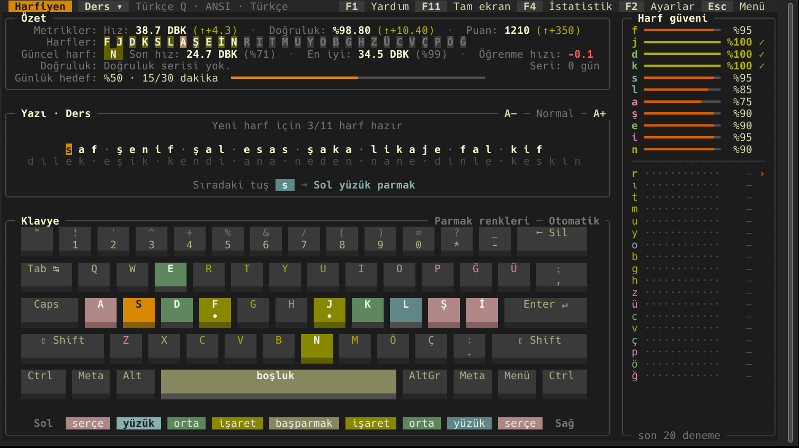

> **Başlamadan önce küçük bir not:** Harfiyen en başta kendi kullanımım için tasarlandı; başkalarının da işine yarayabilir diye paylaşıyorum. Kendi ihtiyaçlarım ve tercihlerim doğrultusunda şekillendiği için herkese hitap etmeyebilir. Öneri ve geri bildirimlerinizi memnuniyetle karşılarım.

## Özellikler

- **Kademeli ders.** Her harfin son 20 denemesi izlenir (pencere boyu ayarlanabilir). Açık
  harflerin hepsi kusursuz olunca sıradaki harf açılır. İsterseniz ustalık için hedef hız da
  şart koşulabilir.
- **Akıllı alıştırma satırları.** Gerçek kelimeler ve açık harflerden üretilen, sesli-sessiz
  dönüşümlü sözde kelimeler. Zayıf harfler ve en son açılan harf daha sık gelir.
- **Dört mod.** Ders, zayıf noktalar (en çok zorlandığınız harfler ve harf çiftleri), hız testi,
  serbest metin (hazır metinler ya da kendi `.txt` dosyalarınız).
- **Büyük harf, noktalama, rakam** seçenekleri; Shift gerektiğinde karşı eldeki Shift tuşu da
  gösterilir.
- **keybr tarzı özet.** Hız, doğruluk ve puan ile bir önceki satıra göre değişimleri, güvene göre
  renklenen harf çipleri, güncel harfin son ve en iyi hızı, öğrenme hızı, doğruluk serisi,
  günlük hedef.
- **Motivasyon.** Günlük hedef ve gün serisi, seviye/XP, 19 rozet, son 14 günün, parmakların,
  harflerin ve hız testlerinin istatistikleri.
- **Okunaklı klavye.** Parmak renkleriyle tuş başlıkları ya da hata ısı haritası; tuş stili
  (derinlik, düz, yüzen), alt kenar yüksekliği ve klavye boyutu ayarlanabilir.
- **Büyük yazı.** Alıştırma satırı küçük, normal, büyük ve dev boyutlarda gösterilebilir; büyük
  boyutlar yerleşik bir piksel yazı tipiyle çizilir.
- **Arayüz dili.** Türkçe ve İngilizce; alıştırma kelimeleri de iki dilde (`arayuz` ve `dil`
  ayarları).
- **Klavye düzenleri.** Türkçe Q, Türkçe F, İngilizce (ABD); fiziksel olarak ISO, ANSI ve 102
  tuşlu ANSI; isteğe bağlı numpad. Her düzen/dil çifti kendi ilerlemesini tutar.
- **Temalar ve ayarlar JSON ile.** Altı yerleşik tema, başka bir temadan miras alan kendi
  temalarınız; ayarlar hem dosyadan hem uygulama içinden (canlı önizlemeyle) değişir.
- **Fare desteği.** Düğmeler, menüler, ayar okları, harf çipleri, tekerlek; her pencerede
  kapatma düğmesi.
- **Tuş aydınlatması.** Tuş başına RGB aydınlatmalı klavyelerde basılacak tuş klavyenin
  üzerinde yanar (OpenRGB üzerinden; Corsair, Razer, Logitech, SteelSeries, ASUS Aura ve
  daha yüzlercesi).
- **Pencere ve tam ekran.** Açılışta pencereyi yeterli boyuta getirebilir, ekranı kaplayabilir
  ya da tam ekrana geçebilir. Tam ekranda ekranın altında, parmaklarınızın fiziksel hizasında
  hangi parmağı kullanacağınızı gösteren göstergeler belirir.

| Tam ekran | Ayarlar | İstatistikler |
|---|---|---|
| 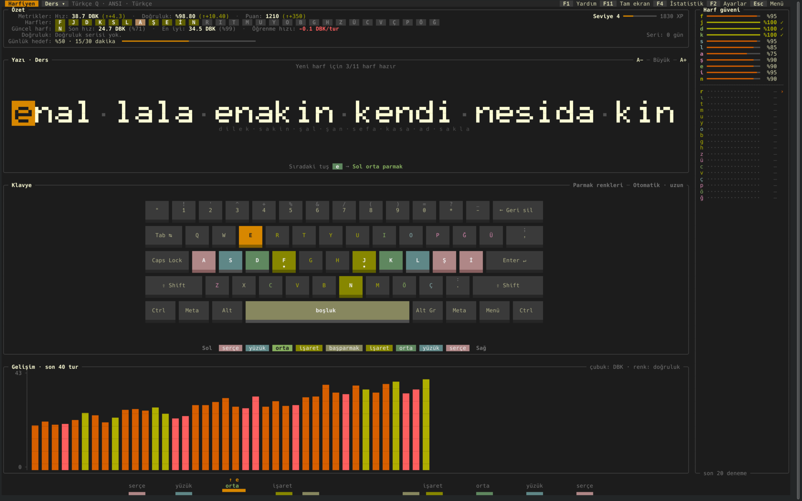 | 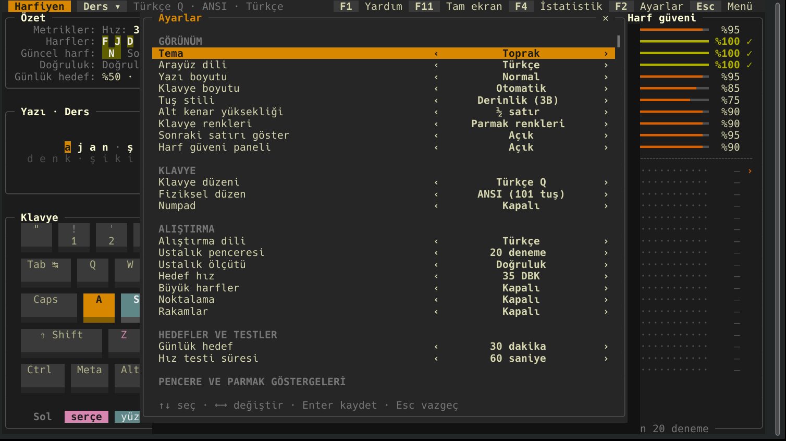 | 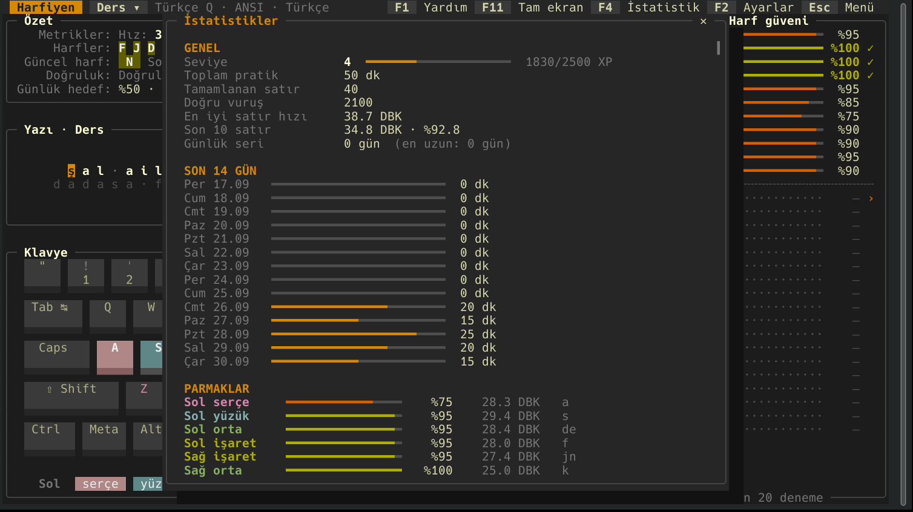 |

## Kurulum

Gereken tek şey Python 3.9 ya da sonrası. Linux'ta geliştirilip denenmiştir; macOS ve diğer
POSIX sistemlerde de çalışması beklenir. Windows'ta standart kütüphanede `curses` bulunmadığı
için doğrudan çalışmaz; WSL kullanılabilir.

**pipx ile (önerilen):**

```sh
pipx install git+https://github.com/lckt0/harfiyen
```

**pip ile:**

```sh
python3 -m pip install --user git+https://github.com/lckt0/harfiyen
```

**Arch Linux:** `paketleme/arch/PKGBUILD` dosyasıyla paket oluşturabilirsiniz (GitHub'daki
`v<sürüm>` etiketinin arşivini indirir). PKGBUILD iki paket üretir: `harfiyen` (terminal ve
masaüstü arayüzü, kısayollarıyla) ve isteğe bağlı `harfiyen-mola` (aşağıya bakın).

```sh
cd paketleme/arch && makepkg -si
```

**Kurmadan:** Uygulama tek dosyadır, indirip çalıştırmanız yeterlidir.

```sh
curl -O https://raw.githubusercontent.com/lckt0/harfiyen/main/harfiyen.py
python3 harfiyen.py
```

**Masaüstü kısayolu (pip/pipx kurulumlarında):**

```sh
install -Dm644 paketleme/harfiyen.desktop ~/.local/share/applications/harfiyen.desktop
```

Masaüstü arayüzünün ve Harfiyen Mola'nın birkaç ek adımı var; bkz.
[Masaüstü arayüzü](#masaüstü-arayüzü) ve [Harfiyen Mola](#harfiyen-mola-isteğe-bağlı).

## Kullanım

```sh
harfiyen                    # kaldığınız yerden devam
harfiyen --ac istatistik    # açılışta bir pencere aç: ayarlar, istatistik, yardim, menu, mod
harfiyen --pencere 10       # bu oturum için ustalık penceresi
harfiyen --temalar          # temaları ve dosya yollarını listele
harfiyen --sifirla          # tüm ilerlemeyi sıfırla
```

İlerleme uygulamanın içinden de sıfırlanabilir: Ayarlar (F2) → Veri → "İlerlemeyi sıfırla".
Açılan pencerede yalnızca etkin profili (alıştırma dili + klavye düzeni) ya da tümünü
(bütün profiller, XP, seviye, rozetler, günlük seri) seçebilirsiniz; önceki kayıt
`progress.json.yedek` dosyasına yedeklenir.

Ekrandaki satırı yazın. Yanlış tuşa bastığınızda imleç ilerlemez, doğru tuşu bekler; o karakter
bir kez "yanlış" sayılır. Hangi parmağı kullanmanız gerektiği hem mesaj satırında hem klavyede
gösterilir.

| Tuş | İşlev |
|---|---|
| Esc | menü |
| Ctrl-C | çıkış onayı (ikinci Ctrl-C çıkar) |
| Tab | yeni satır |
| F1 | yardım |
| F2 | ayarlar |
| F3 | hata ısı haritası aç/kapat |
| F4 | istatistikler |
| F5 / F6 | yazıyı küçült / büyüt |
| F7 | klavye boyutu |
| F8 | alıştırma modu |
| F11 | tam ekran aç/kapat |

Fareyle üst çubuktaki düğmelere, mod çipine, harf çiplerine (harf ayrıntısı), ayar oklarına ve
pencerelerin ✕ düğmesine tıklayabilirsiniz. Menü ve bilgi pencereleri dışarı tıklayınca kapanır.

## Masaüstü arayüzü

Terminal dışında bir de Qt Quick ile çizilen masaüstü arayüzü var: `harfiyen-masaustu`.
Aynı çekirdeği, aynı ilerleme dosyasını, ayarları ve temaları kullanır; terminalde
kaldığınız yerden devam eder.

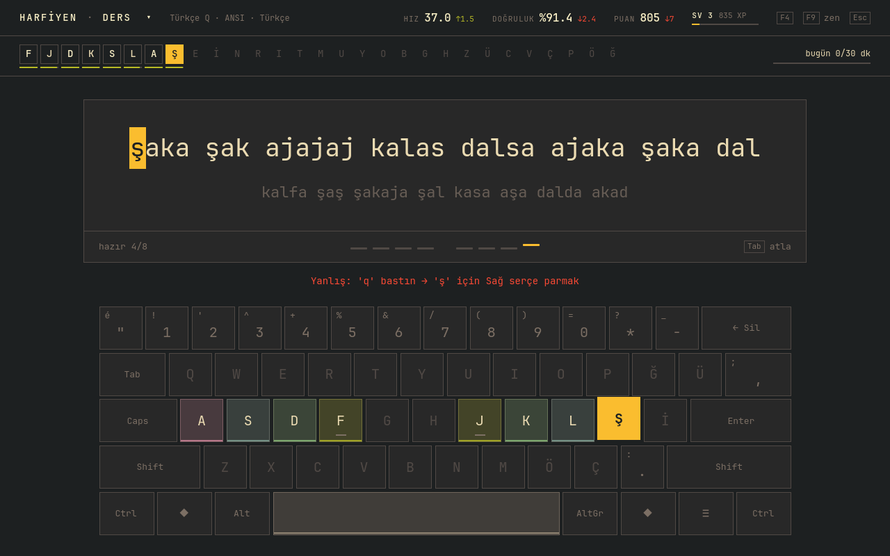

- **Odak kartı.** Yazılacak satır ortadaki kartta büyük yazıyla, sonraki satır sönük olarak
  altında. İmleç harften harfe kayar; yanlış tuşta kart hafifçe sarsılır ve tuş klavyede
  kırmızı yanar. Kartın altında 4+4 parmak çizgisi var: sıradaki parmak yukarı kalkar.
- **Üst şerit.** Son satırın hızı, doğruluğu ve puanı (bir öncekine göre değişimle), seviye
  ve XP; altında güvene göre çizgilenen harf çipleri ve günlük hedef.
- **Klavye.** Açık harfler parmak renginde hafif tonlu; basılacak tuş vurgu renginde kalkar,
  Shift gerekiyorsa karşı eldeki Shift çerçevelenir. Pencere basıksa klavye kendiliğinden
  gizlenir.
- **Zen modu (F9).** Yalnızca yazı ve parmak çizgileri kalır.
- **Harf güveni paneli (F4).** Harf başına güven çubukları ve son turların hız grafiği.
- **Dört mod (F8)**, hız testi sonucu (yeni rekor rozetiyle), menü (Esc).

| Zen modu | Gündüz teması ve harf paneli | Hız testi |
|---|---|---|
| 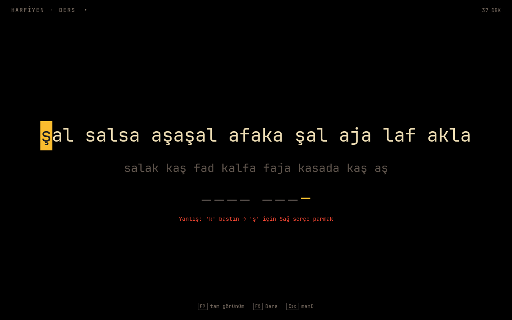 | 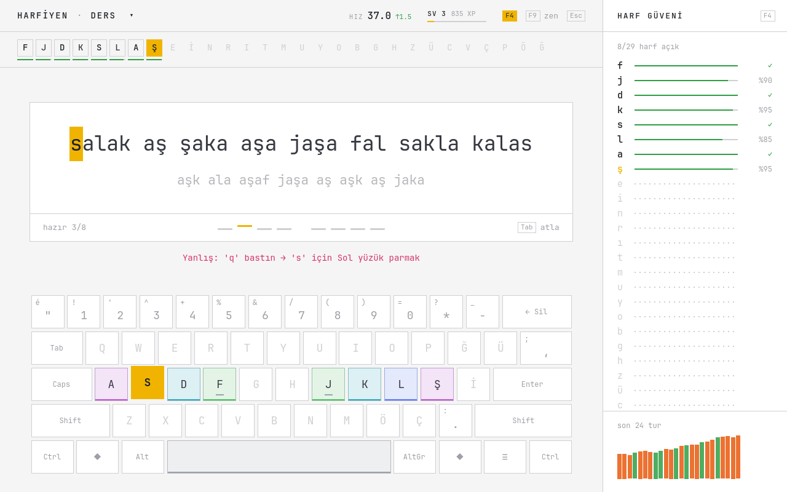 | 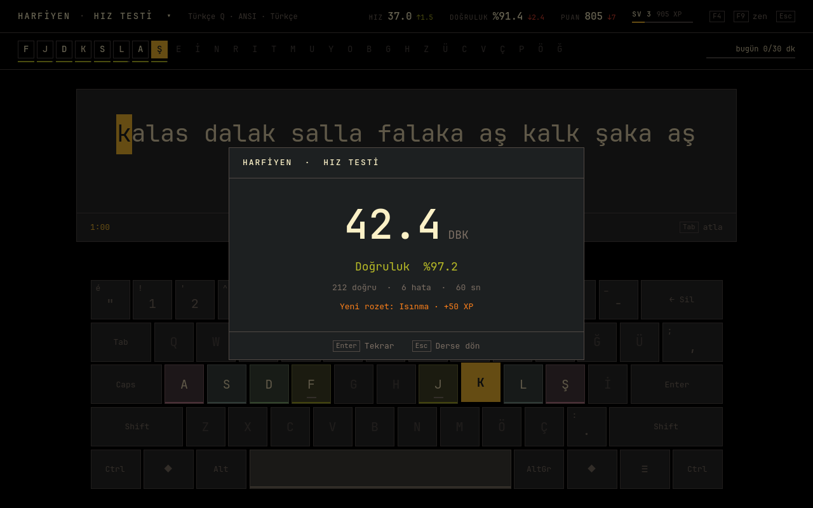 |

Kısayollar: **Tab** satırı atla · **Esc** menü · **F4** harf paneli · **F8** mod ·
**F9** zen · **F11** tam ekran · **Ctrl+Q** çık.

Kurulum: PySide6 (6.5+) gerekir; yazı tipi olarak JetBrains Mono kullanılır (yoksa sistemin
eş aralıklı yazı tipi).

```sh
pipx install "harfiyen[masaustu] @ git+https://github.com/lckt0/harfiyen"
install -Dm644 paketleme/harfiyen-masaustu.desktop ~/.local/share/applications/harfiyen-masaustu.desktop
```

Arch'ta `pyside6` ve `ttf-jetbrains-mono` paketleri yeterli; depodan doğrudan
`python3 -m harfiyen_masaustu` ile de çalışır. Görünüm tercihleri (zen, panel, satır
uzunluğu) `~/.config/harfiyen/masaustu.json` dosyasında. Terminal ve masaüstü arayüzünü
aynı anda açmayın: ikisi de aynı ilerleme dosyasına yazar (masaüstü arayüzü bu durumda uyarır).

## Harfiyen Mola (isteğe bağlı)

Medya oynarken (ör. dizi izlerken) her 10 dakikada bir ekranın üstüne 10 kelimelik bir
on parmak alıştırması çıkarır. Çıktığı an oynayan medyayı duraklatır, yazı bitince
(ya da Esc ile atlanınca) yalnızca kendi duraklattığı medyayı sürdürür. Kelimeler
Harfiyen'in ders modundan gelir, vuruşlar Harfiyen ilerlemesine işlenir. Kaynağı
`mola/` dizinindedir.

| Alıştırma | Yeni rekor |
|---|---|
| 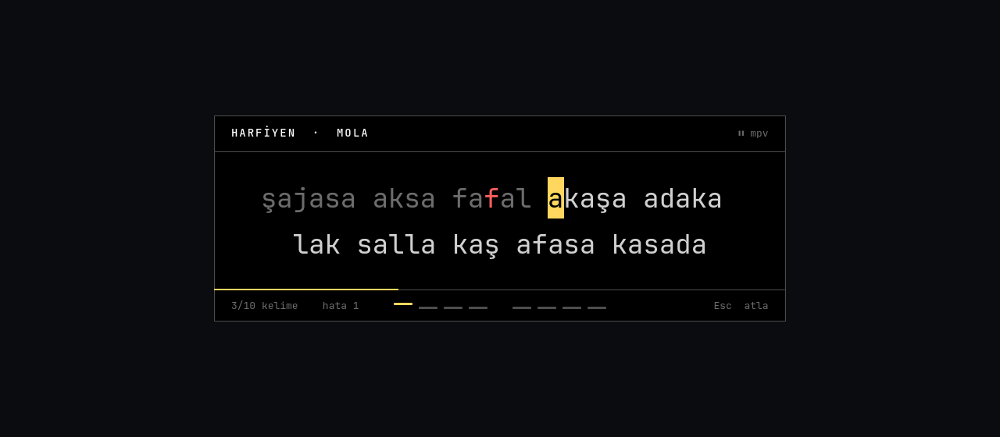 | 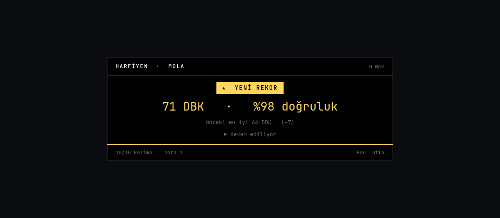 |

- **İzleme sayacı.** MPRIS oynatma süresini biriktirir. Duraklatılan süre sayılmaz ama
  birikeni de silmez; ileri/geri sarma ve birkaç saniyelik durdurmalar sayacı bozmaz.
  `ara_sifirla_dk`'dan uzun süre hiçbir şey oynamazsa sayaç baştan başlar. Durum yalnızca
  `PropertiesChanged` sinyalinde ve bir oynatıcı açılıp kapandığında okunur; beklerken
  süreç uyanmaz.
- **Pencere.** QML + LayerShellQt, `overlay` katmanı (tam ekran videonun üstünde), klavye
  `exclusive`. Renkler Harfiyen'de seçili temadan gelir. Kartın altındaki 4+4 çizgide
  sıradaki harfe basacak parmak yukarı kalkar.
- **Kelimeler.** Yalnızca açık harfler, zayıf harflere ağırlık. Harfiyen açıksa ilerlemeye
  yazılmaz.
- **Rekor.** Her turun DBK'sı en iyi mola turuyla karşılaştırılır; geçilirse "YENİ REKOR"
  rozeti ve önceki en iyiyle fark görünür. `rekor_en_az_dogruluk`'un altındaki tur rekor
  sayılmaz. Kayıt `~/.local/share/harfiyen/mola-rekor.json` dosyasındadır.
- **Medya.** MPRIS (D-Bus) destekleyen her oynatıcı: tarayıcılar, VLC, Spotify vb. mpv
  için `mpv-mpris` gerekir. Ekran kilitliyken çıkmaz.

**Gereksinimler.** Wayland oturumu ve layer-shell destekleyen bir bileşik yönetici (KDE
Plasma, Sway, Hyprland vb.), PySide6, dbus-python ve LayerShellQt'nin QML modülü. Bu üçü
sistem paketlerinden gelmelidir: pip'teki PySide6 tekerleği sistemin LayerShellQt
eklentisini yükleyemez.

```sh
sudo pacman -S pyside6 python-dbus layer-shell-qt ttf-jetbrains-mono    # Arch
```

Diğer dağıtımlarda aynı bileşenlerin (PySide6 QtQuick ve QtDBus, dbus-python, Qt 6 için
LayerShellQt) karşılığı olan paketleri kurun.

**Kurulum (Arch).** `makepkg -si` ile `harfiyen-mola` paketini de kurun, sonra servisi
kullanıcınız için açın:

```sh
systemctl --user enable --now harfiyen-mola
```

**Kurulum (pipx).** Sistem paketlerini görebilmesi için `--system-site-packages` ile kurun;
systemd kullanıcı servisi ve kısayol depodaki dosyalardan kopyalanır:

```sh
pipx install --system-site-packages git+https://github.com/lckt0/harfiyen
git clone https://github.com/lckt0/harfiyen && cd harfiyen
mkdir -p ~/.config/systemd/user
sed 's|/usr/bin/harfiyen-mola|%h/.local/bin/harfiyen-mola|' mola/paketleme/harfiyen-mola.service \
    > ~/.config/systemd/user/harfiyen-mola.service
mkdir -p ~/.local/share/applications
sed "s|^Exec=harfiyen-mola|Exec=$HOME/.local/bin/harfiyen-mola|" mola/paketleme/harfiyen-mola.desktop \
    > ~/.local/share/applications/harfiyen-mola.desktop
systemctl --user daemon-reload
systemctl --user enable --now harfiyen-mola
```

pip ile kurduysanız (`python3 -m pip install --user ...`) yollar aynıdır.

**Kullanım.** Servis arka planda bekler. Uygulamalar listesindeki **Harfiyen Mola**
(`harfiyen-mola --ac`) alıştırmayı hemen gösterir: servis çalışıyorsa ona `SIGUSR1` gönderir
(sayaç da sıfırlanır), çalışmıyorsa tek seferlik açılır. Elle denemek için:
`harfiyen-mola --simdi --her-zaman`.

**Ayarlar** `~/.config/harfiyen/mola.json` dosyasındadır (ilk çalıştırmada oluşturulur):

| Anahtar | Varsayılan | Anlamı |
|---|---|---|
| `aralik_dk` | 10 | Bu kadar dakika medya oynayınca çıkar |
| `ara_sifirla_dk` | 5 | Bundan uzun süre hiçbir şey oynamazsa sayaç baştan başlar |
| `kelime` | 10 | Yazdırılacak kelime sayısı (40 karakteri aşan yazı kelime sınırından satırlara bölünür) |
| `parmak_goster` | false | Yazının altında sıradaki harfin parmağını gösterir (ör. "Sağ işaret parmak") |
| `haric_oynaticilar` | ["kdeconnect"] | Bu adları içeren MPRIS oynatıcılarına dokunmaz, saymaz |
| `ilerlemeye_kaydet` | true | Vuruşları Harfiyen ilerlemesine işler |
| `sonuc_suresi_sn` | 1.6 | Sonucun ekranda kalma süresi |
| `rekor_en_az_dogruluk` | 90 | Bu doğruluğun (%) altındaki tur rekor sayılmaz |

Değişiklikten sonra: `systemctl --user restart harfiyen-mola`

## Ayarlar

Ayarlar `~/.config/harfiyen/ayarlar.json` dosyasındadır; aynı ayarları uygulama içinden F2 ile
değiştirebilirsiniz. Tanınmayan ya da geçersiz değerler uyarıyla varsayılana döner.

| Anahtar | Değerler | Açıklama |
|---|---|---|
| `tema` | `siyah`, `gece`, `gunduz`, `toprak`, `kontrast`, `terminal` ya da kendi temanız | renk teması |
| `arayuz` | `tr`, `en` | arayüz dili |
| `yazi_boyutu` | `kucuk`, `normal`, `buyuk`, `dev` | alıştırma satırının boyutu |
| `klavye_boyutu` | `otomatik_k`, `otomatik_uzun`, `gizli`, `kompakt`, `orta`, `buyuk` | tuş yüksekliği |
| `tus_stili` | `derinlik`, `duz`, `yuzen` | tuşların alt kenarı |
| `tus_kenar` | `1`, `4`, `8`, `12`, `16` | alt kenar yüksekliği (sekizde bir satır) |
| `klavye_gorunumu` | `parmak`, `isi` | parmak renkleri ya da hata ısı haritası |
| `sonraki_satir`, `harf_paneli` | `true`, `false` | sonraki satır önizlemesi, harf güveni paneli |
| `yazi_parmak` | `true`, `false` | yazının hemen altında parmak göstergesi şeridi (basılacak parmak, yönü ve harfi) |
| `klavye` | `tr-q`, `tr-f`, `us` | klavye düzeni |
| `fiziksel` | `iso`, `ansi`, `ansi102` | fiziksel düzen |
| `numpad` | `true`, `false` | sayısal tuş takımı |
| `dil` | `tr`, `en` | alıştırma dili |
| `ustalik_penceresi` | 5–50 | ustalık için bakılan son deneme sayısı |
| `ustalik_olcutu` | `dogruluk`, `dogruluk_hiz` | ustalık ölçütü |
| `hedef_hiz` | 10–150 | hedef hız (DBK: dakikada beş karakterlik kelime) |
| `buyuk_harf`, `noktalama`, `rakamlar` | `true`, `false` | alıştırma satırına eklenenler |
| `gunluk_hedef_dk` | 0–240 | günlük hedef (dakika, 0 = kapalı) |
| `test_suresi_sn` | 15–300 | hız testi süresi |
| `acilis_boyutu` | `dokunma`, `yeterli`, `kapla`, `tam_ekran` | açılışta pencere |
| `gosterge` | `kapali`, `otomatik`, `her_zaman` | parmak göstergeleri (otomatik: tam ekrandayken) |
| `gosterge_kaydirma_mm`, `gosterge_olcek` | mm, % | göstergelerin konum ince ayarı |
| `tus_araligi_mm`, `ekran_genisligi_mm` | mm (0 = otomatik) | fiziksel ölçüler |
| `fare` | `true`, `false` | fare desteği |
| `rgb_isik` | `kapali`, `openrgb` | tuş aydınlatması |
| `rgb_zemin` | `kapali`, `soluk`, `parmak` | diğer tuşlar: sönük, soluk beyaz ya da açık harfler parmak renklerinde |
| `rgb_parlaklik` | 10–100 | aydınlatma parlaklığı (%) |
| `rgb_adres` | `konak:port` | OpenRGB SDK sunucusu (yalnızca dosyadan; varsayılan `127.0.0.1:6742`) |

<details>
<summary>Tuş stilleri ve alt kenar yükseklikleri</summary>

Yukarıdan aşağıya: derinlik ⅛ satır, derinlik ½ satır (varsayılan), derinlik 1½ satır, düz,
yüzen.

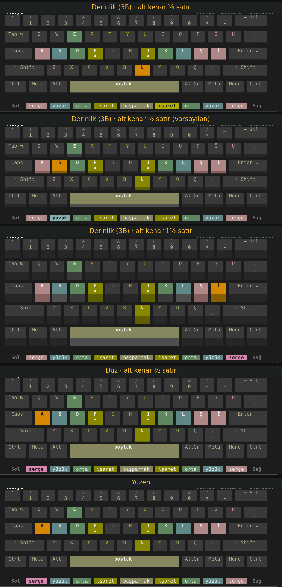

</details>

## Temalar

Kendi temanızı `~/.config/harfiyen/temalar/` dizinine bir JSON dosyası olarak koyun; tema kimliği
dosya adıdır. `miras` ile bir temayı temel alıp yalnızca değiştirmek istediğiniz alanları
yazmanız yeterlidir. İlk çalıştırmada açıklamalı bir `ornek.json` oluşturulur.

```json
{
  "ad": "Benim temam",
  "miras": "gece",
  "vurgu": "#ff8fab",
  "tus_karisim": 0.5,
  "parmak": { "serce": "#b197fc", "isaret": "#8ce99a" }
}
```

Renkler `#rrggbb`, `#rgb`, 0–255 arası xterm renk numarası, `red` gibi bir ad ya da `null`
(terminalin kendi rengi) olabilir. Alanlar: `zemin`, `yuzey`, `yazi`, `soluk`, `cizgi`, `baslik`,
`vurgu`, `vurgu_yazi`, `dogru`, `hata`, `hata_yazi`, `uyari`, `tus_yazi`, `ust_zemin`, `ust_yazi`,
`golge` ve `parmak` altında `serce`, `yuzuk`, `orta`, `isaret`, `basparmak`. İsteğe bağlı
`tus_karisim` (0–1) tuş dolgusunda parmak renginin payını, `tus_notr` harf dışı tuşların
dolgusunu belirler.

Terminaller 256 renk paletiyle çizildiği için renkler en yakın palet rengine yuvarlanır;
yuvarlama renk tonunu koruyacak biçimde yapılır.

## Tuş aydınlatması (OpenRGB)

Klavyeniz tuş başına RGB aydınlatmayı destekliyorsa Harfiyen basmanız gereken tuşu klavyenin
üzerinde yakar: hedef tuş temanın vurgu renginde, gerekiyorsa karşı eldeki Shift yarı
parlaklıkta, yanlış bastığınız tuş kısa bir an kırmızı. İsterseniz açık harfler parmak
renklerinde soluk yanar. Çıkarken klavyenin önceki ışıkları ve efekti geri yüklenir.

Harfiyen ışıkları [OpenRGB](https://openrgb.org)'nin SDK sunucusu üzerinden yönetir; bu yüzden
tek bir yöntemle yüzlerce markayı destekler ve ek bağımlılık gerektirmez.

1. OpenRGB'yi kurun (Arch: `pacman -S openrgb`) ve udev kurallarının yüklü olduğundan emin olun.
2. OpenRGB'de **SDK Server** sekmesinden sunucuyu başlatın ya da OpenRGB'yi
   `openrgb --server --startminimized` ile çalıştırın.
3. Harfiyen'de **Ayarlar → Klavye aydınlatması → Tuş aydınlatması: OpenRGB** seçin. Üst
   çubuktaki `RGB` çipi bağlantıyı gösterir (yeşil: bağlı, kırmızı: bağlanamadı; 15 saniyede
   bir yeniden denenir).

Tuşlar karaktere göre değil fiziksel konuma göre eşlenir; Türkçe Q'daki `ş`, klavyenin
üzerinde ne yazarsa yazsın ABD düzenindeki `;` tuşunun yerindedir. Yalnızca bölgesel (zone)
aydınlatması olan klavyeler bu özelliği desteklemez.

<details>
<summary>OpenRGB sunucusundan okunan LED renkleri</summary>

Harfiyen çalışırken OpenRGB'nin deneme klavyesinden okunan gerçek LED renkleri: büyük harf
hedefi ve karşı eldeki Shift, yanlış tuş ve çıkıştan sonra geri yüklenen ışıklar.

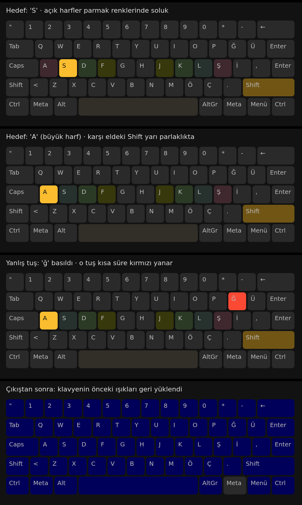

</details>

## Terminal uyumluluğu

Harfiyen herhangi bir terminale bağlı değildir; terminale özgü yetenekler için önce standart yol,
sonra masaüstüne özgü bir yedek denenir, ikisi de yoksa uygulama küçük düzene geçer.

- **Pencere boyutu ve tam ekran:** KDE Plasma'da terminal hangisi olursa olsun KWin betiğiyle;
  diğer masaüstlerinde xterm kaçış kodlarıyla (`CSI 8/9/10 t`). Bu kodların desteği terminale
  göre değişir: örneğin Konsole pencere boyutunu değiştirir, ghostty 1.3 yok sayar.
- **Parmak göstergeleri:** Ekranın fiziksel genişliği EDID'den okunur; KDE'de pencere konumu
  KWin'den alınır. Diğer ortamlarda `gosterge` ayarını `her_zaman` yapıp ince ayarla
  hizalayabilirsiniz.
- **En az boyut:** 72×22. Daha büyük pencerelerde düzen kendiliğinden büyür.

## Dosyalar

| Yol | İçerik |
|---|---|
| `~/.config/harfiyen/ayarlar.json` | ayarlar |
| `~/.config/harfiyen/temalar/*.json` | kendi temalarınız |
| `~/.config/harfiyen/metinler/*.txt` | serbest metin modu için metinler |
| `~/.local/share/harfiyen/progress.json` | ilerleme, istatistikler, rozetler |
| `~/.local/share/harfiyen/progress.json.yedek` | uygulama içinden yapılan son sıfırlamadan önceki kayıt |
| `~/.config/harfiyen/mola.json` | Harfiyen Mola ayarları |
| `~/.local/share/harfiyen/mola-rekor.json` | Harfiyen Mola rekoru |

`XDG_CONFIG_HOME` ve `XDG_DATA_HOME` değişkenlerine uyulur.

## Kaldırma

Harfiyen Mola etkinse önce servisini durdurun:

```sh
systemctl --user disable --now harfiyen-mola
```

### Arch Linux (paket)

```sh
sudo pacman -Rns harfiyen-mola harfiyen      # ya da yalnızca: sudo pacman -Rns harfiyen
```

### pipx / pip

```sh
pipx uninstall harfiyen                      # ya da: python3 -m pip uninstall harfiyen
rm -f ~/.local/share/applications/harfiyen.desktop \
      ~/.local/share/applications/harfiyen-masaustu.desktop \
      ~/.local/share/applications/harfiyen-mola.desktop \
      ~/.config/systemd/user/harfiyen-mola.service
systemctl --user daemon-reload
```

### Tek dosya

İndirdiğiniz `harfiyen.py` dosyasını silmeniz yeterli.

### Ayarlar ve ilerleme (isteğe bağlı)

Harfiyen sistem ayarlarını değiştirmez. Pencere boyutu için kullandığı KWin betiği yalnızca
çalışırken yüklenir, klavyenin kendi aydınlatması da çıkışta geri yüklenir. İlerlemenizi,
ayarlarınızı, temalarınızı ve metinlerinizi de silmek isterseniz:

```sh
rm -r ~/.config/harfiyen ~/.local/share/harfiyen
```

## Geliştirme

```sh
python3 harfiyen.py                                # doğrudan çalıştırma
python3 -m harfiyen_masaustu                       # masaüstü arayüzü
python3 -m unittest discover -s tests -t . -v      # testler (masaüstü testleri PySide6 ister)
python3 -m unittest discover -s mola/tests -v      # Harfiyen Mola testleri (PySide6, dbus-python)
PYTHONPATH=mola python3 -m harfiyen_mola --simdi --her-zaman --kaydetme   # mola'yı depodan dene
# masaüstü arayüzünü pencere açmadan PNG'ye çizmek (belgeler, görsel denetim):
QT_QPA_PLATFORM=offscreen python3 -m harfiyen_masaustu --goruntu ekran.png --zen
```

Ayrıntılar için [CONTRIBUTING.md](CONTRIBUTING.md), sürüm notları için
[CHANGELOG.md](CHANGELOG.md).

## Lisans

[MIT](LICENSE.md)

